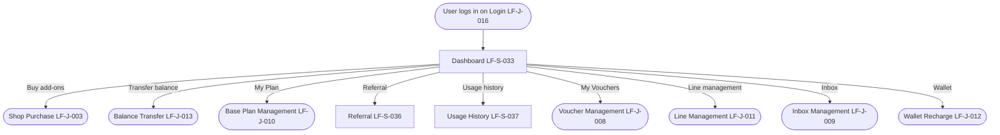

# PRD: LF-J-017 - Dashboard

## 1. Change Log

| Date | Change | Owner | Rationale |
|------|--------|-------|-----------|

## 2. Header

| Field | Value |
|-------|-------|
| Feature | Dashboard |
| Channels | App + Web |
| Status (owning team) | PM — drafting |
| Owner (PM) | Nan Dong |
| Contributors | Nan Dong |
| Created | 2026-09-21 |
| Last updated | 2026-09-21 |
| Figma | N / A |
| Confluence | [PRD: LF-J-017 - Dashboard](https://lotusflare.atlassian.net/wiki/spaces/AIDR/pages/7847903272/PRD+LF-J-017+-+Dashboard) |
| Jira | — |
| API Spec | N / A |
| Links (optional) | shared context: [Shared general context](https://lotusflare.atlassian.net/wiki/spaces/AIDR/pages/7693467649/Shared+general+context+product-wide+rules) |

## 3. Central requirement + Scope

### a. Central requirement

The Dashboard journey is where the logged-in user checks their balances and opens other account management sections.

### b. Goals

- Check their balances
- Redirect to other account management sections

### c. Non-Goals

N / A

### d. Entry points

N / A

### e. Exit points

N / A

## 4. User Journey

## 5. Acceptance Criteria

N / A

## 6. Edge cases & error cases

N / A

## 7. Data Mapping

N / A
