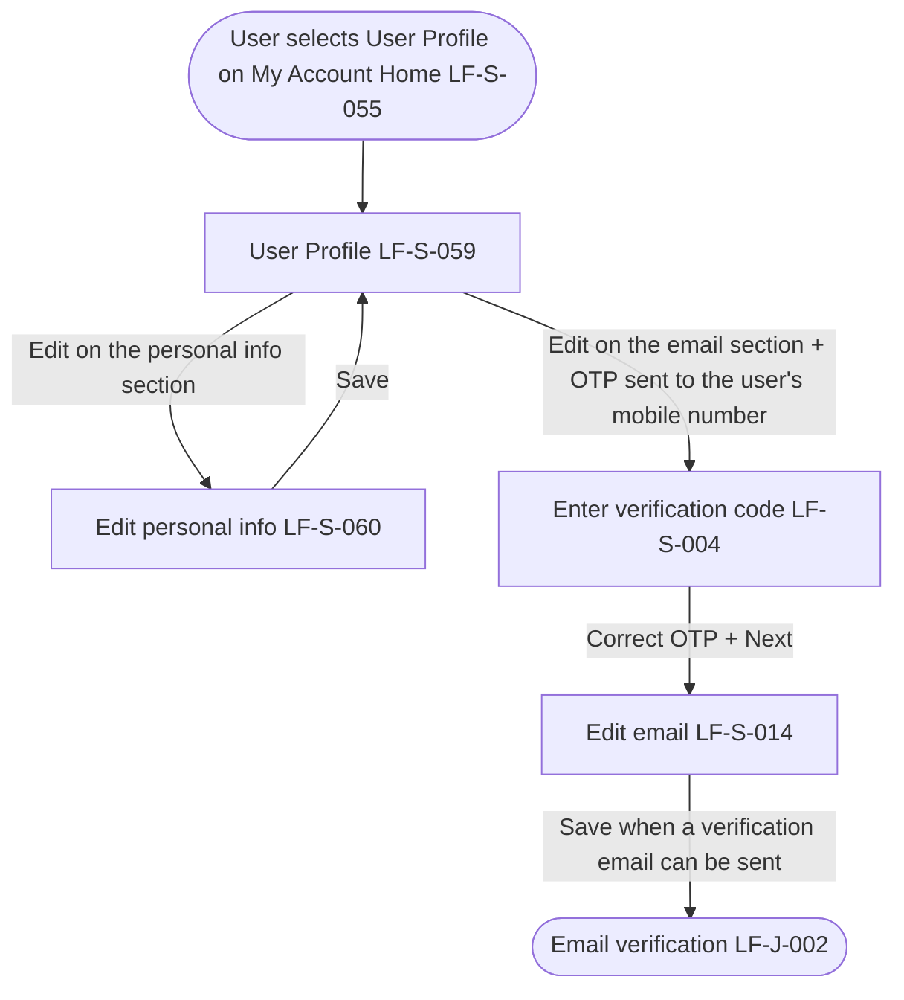

# PRD: LF-J-018 - User profile editing

## Change Log

| Date | Change | Owner | Rationale |
|------|--------|-------|-----------|

## Header

| Field | Value |
| --- | --- |
| Feature | User profile editing |
| Channels | App + Web |
| Status (owning team) | PM — drafting |
| Gaps | none |
| Version | 1 |
| Created | 2026-09-28 |
| Last updated | 2026-10-21 |
| Owner (PM) | Nan Dong |
| Contributors | Nan Dong |
| Figma | [Prebuilt Page Templates — User profile editing](https://www.figma.com/design/X3GsrESJS5Ygq67qI0GJ8D/Prebuilt-Page-Templates?node-id=604-26011) |
| API Spec(s) | N / A |
| Jira | — |
| Confluence | [PRD: LF-J-018 - User profile editing](https://lotusflare.atlassian.net/wiki/spaces/AIDR/pages/7875166331/PRD+LF-J-018+-+User+profile+editing) |
| Links (optional) | shared context: [Shared general context](https://lotusflare.atlassian.net/wiki/spaces/AIDR/pages/7693467649/Shared+general+context+product-wide+rules) |

## Central requirement + Scope

### Central requirement

The user profile editing journey is where the logged-in user reviews their personal information and updates their personal information or email.

### Goals

- Review their personal information
- Update their first name, last name, gender, and birthday
- Update their email

### Non-Goals

N / A

### Entry points

N / A

### Exit points

N / A

## User Journey

## Acceptance Criteria

N / A

## Edge cases & error cases

N / A

## Data Mapping

N / A
