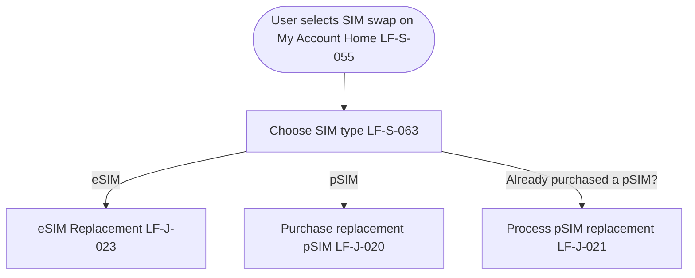

# PRD: LF-J-024 - SIM Swap

## Change Log

| Date | Change | Owner | Rationale |
|------|--------|-------|-----------|

## Header

| Field | Value |
| --- | --- |
| Feature | SIM Swap |
| Channels | App + Web |
| Status (owning team) | PM — drafting |
| Gaps | none |
| Version | 1 |
| Created | 2026-09-30 |
| Last updated | 2026-09-30 |
| Owner (PM) | Nan Dong |
| Contributors | Nan Dong |
| Figma | N / A |
| API Spec(s) | N / A |
| Jira | — |
| Confluence | [PRD: LF-J-024 - SIM Swap](https://lotusflare.atlassian.net/wiki/spaces/AIDR/pages/7876018203/PRD+LF-J-024+-+SIM+Replacement) |
| Links (optional) | shared context: [Shared general context](https://lotusflare.atlassian.net/wiki/spaces/AIDR/pages/7693467649/Shared+general+context+product-wide+rules) |

## Central requirement + Scope

### Central requirement

The SIM swap journey is where the logged-in user replaces their SIM with an eSIM or a pSIM.

### Goals

- Replace their SIM with an eSIM or a pSIM

### Non-Goals

N / A

### Entry points

N / A

### Exit points

N / A

## User Journey

## Acceptance Criteria

N / A

## Edge cases & error cases

N / A

## Data Mapping

N / A
