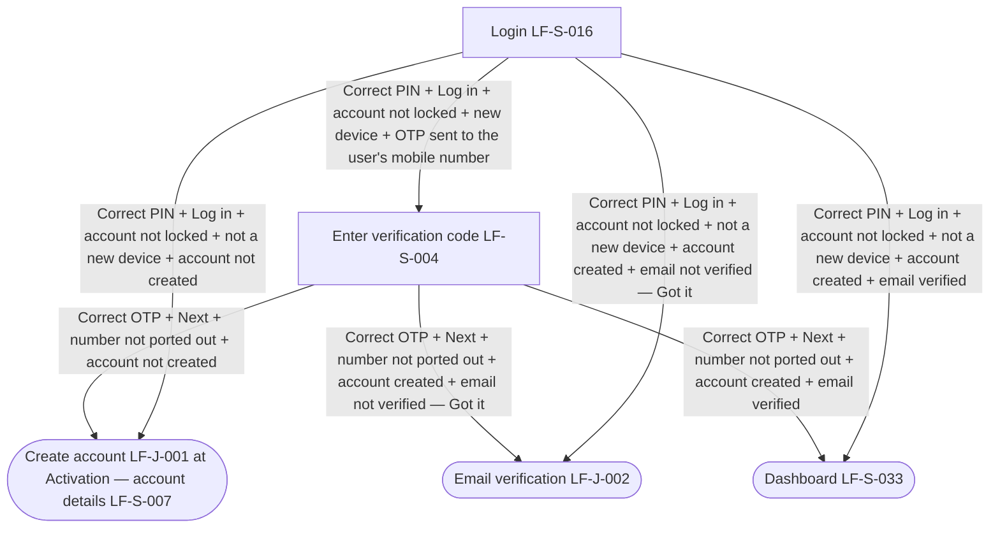

# PRD: LF-J-035 - Login delta

## Change Log

| Date | Change | Owner | Rationale |
|------|--------|-------|-----------|

## Header

| Field | Value |
| --- | --- |
| Feature | Login delta |
| Channels | App + Web |
| Status (owning team) | PM — drafting |
| Gaps | none |
| Version | 1 |
| Created | 2026-10-14 |
| Last updated | 2026-10-21 |
| Owner (PM) | Nan Dong |
| Contributors | Nan Dong |
| Figma | [Prebuilt Page Templates — Login delta](https://www.figma.com/design/X3GsrESJS5Ygq67qI0GJ8D/Prebuilt-Page-Templates?node-id=649-33775) |
| API Spec(s) | N / A |
| Jira | — |
| Confluence | [PRD: LF-J-035 - Login delta](https://lotusflare.atlassian.net/wiki/spaces/AIDR/pages/7925563540/PRD+LF-J-035+-+Login+missing+account+delta) |
| Links (optional) | based on: [PRD: LF-J-016 - Login](https://lotusflare.atlassian.net/wiki/spaces/AIDR/pages/7827816774/PRD+LF-J-016+-+Login) shared context: [Shared general context](https://lotusflare.atlassian.net/wiki/spaces/AIDR/pages/7693467649/Shared+general+context+product-wide+rules) |

## Central requirement + Scope

### Central requirement

The login delta starts after a correct PIN. Account locked is checked before any other login outcome. A locked account shows Account locked and does not continue. When this is a new device and the account is not locked, login asks for a verification code. A wrong code does not take the user to another screen. After the correct code, a ported-out number shows Number ported out and does not continue. If the number is not ported out and the account is not created, login continues create account at account details. If the account is created and the email is not verified, login shows Email not verified. **Got it** takes the user to Email verification. If the account is created and the email is verified, login opens Dashboard. When this is not a new device, the account is not locked, and the account is not created, login continues create account at account details. When this is not a new device, the account is not locked, the account is created, and the email is not verified, login shows Email not verified. **Got it** takes the user to Email verification. When this is not a new device, the account is not locked, the account is created, and the email is verified, login opens Dashboard.

### Goals

- Show Account locked before any other login outcome
- Confirm a verification code when this is a new device and the account is not locked
- Leave the user on the verification code when the code is wrong
- Show Number ported out after the correct code
- After that code, continue create account at account details when the account is not created
- After that code, show Email not verified when the account is created and the email is not verified
- After that code, open Dashboard when the account is created and the email is verified
- Continue create account at account details when this is not a new device and the account is not created
- Show Email not verified when this is not a new device, the account is created, and the email is not verified
- Open Dashboard when this is not a new device, the account is created, and the email is verified

### Non-Goals

N / A

### Entry points

N / A

### Exit points

N / A

## User Journey

## Acceptance Criteria

N / A

## Edge cases & error cases

| ID | Case (category) | Trigger / entry | Expected behavior (observable) | Exit / recovery |
| --- | --- | --- | --- | --- |
| EC-01 | Error — account locked | The user enters the correct mobile number and the correct 6-digit PIN for a number that Login has locked and selects **Log in** | - Title **Account locked** is shown - Message "Sorry, your account is temporarily locked! You may try again after 5 minutes." is shown - **Got it** is shown - This is checked before a verification code, account details, Email not verified, and Dashboard | **Got it** closes the message and the user stays on the login screen |
| EC-02 | Error — wrong code | The user enters a wrong verification code and selects **Next** | The user is not taken to account details, Email verification, or Dashboard, and **Number ported out** is not shown | The user stays on Enter verification code (LF-S-004) |
| EC-03 | Error — number ported out | The user enters the correct verification code and selects **Next**, and that number has been ported out | - Title **Number ported out** is shown - Message "Sorry, you have been ported out." is shown - **Got it** is shown - The user is not taken to account details, Email verification, or Dashboard | **Got it** closes the message and the user stays on Enter verification code (LF-S-004) |
| EC-04 | Error — email not verified | The user enters the correct verification code and selects **Next**, the number is not ported out, the account is created, and the email is not verified | - Title **Email not verified** is shown - Message "Your account is not yet verified. Click the verification link sent to your email to proceed." is shown - **Got it** is shown | **Got it** takes the user to Email verification (LF-J-002) |

## Data Mapping

N / A
