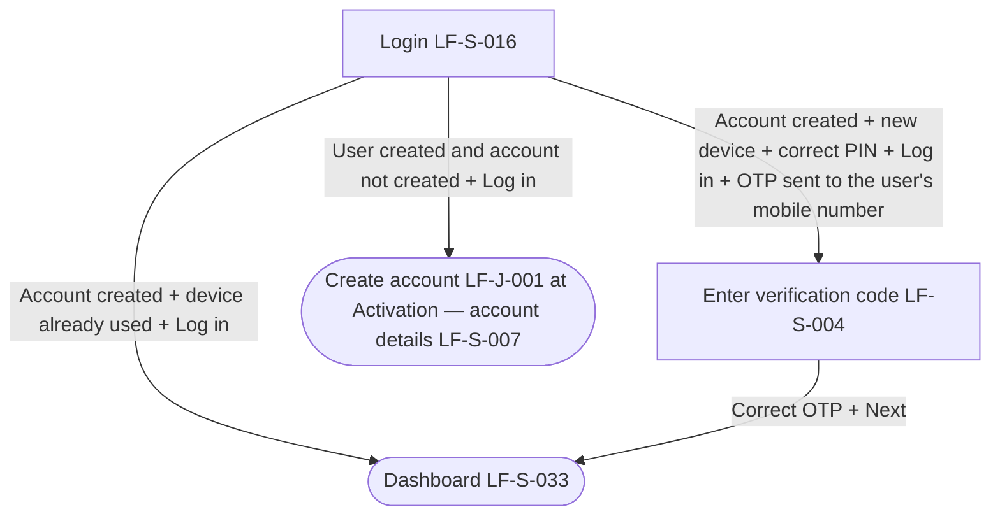

# PRD: LF-J-035 - Login delta

## 1. Change Log

| Date | Change | Owner | Rationale |
|------|--------|-------|-----------|

## 2. Header

| Field | Value |
|-------|-------|
| Feature | Login delta |
| Channels | App + Web |
| Status (owning team) | PM — drafting |
| Owner (PM) | Nan Dong |
| Contributors | Nan Dong |
| Created | 2026-10-14 |
| Last updated | 2026-10-14 |
| Figma | N / A |
| Confluence | [PRD: LF-J-035 - Login delta](https://lotusflare.atlassian.net/wiki/spaces/AIDR/pages/7925563540/PRD+LF-J-035+-+Login+missing+account+delta) |
| Jira | — |
| API Spec | N / A |
| Links (optional) | based on: [PRD: LF-J-016 - Login](https://lotusflare.atlassian.net/wiki/spaces/AIDR/pages/7827816774/PRD+LF-J-016+-+Login) shared context: [Shared general context](https://lotusflare.atlassian.net/wiki/spaces/AIDR/pages/7693467649/Shared+general+context+product-wide+rules) |

## 3. Central requirement + Scope

### a. Central requirement

The login delta is the change to login that continues create account when the user is created and the account is not, and asks for a verification code when the user logs in on a new device.

### b. Goals

- Continue create account when the user is created and the account is not
- Confirm a verification code when logging in on a new device

### c. Non-Goals

N / A

### d. Entry points

N / A

### e. Exit points

N / A

## 4. User Journey

## 5. Acceptance Criteria

N / A

## 6. Edge cases & error cases

N / A

## 7. Data Mapping

N / A
